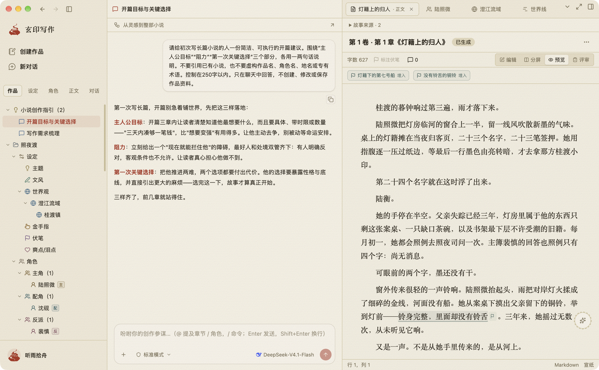
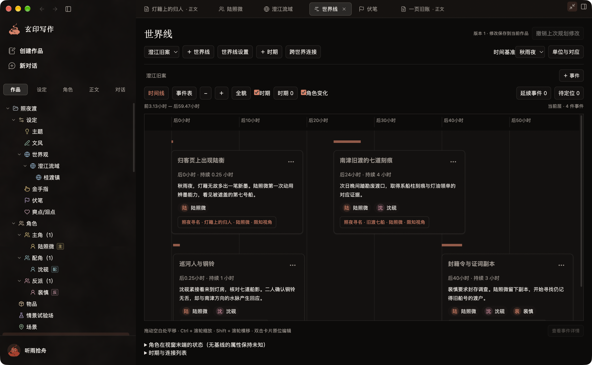
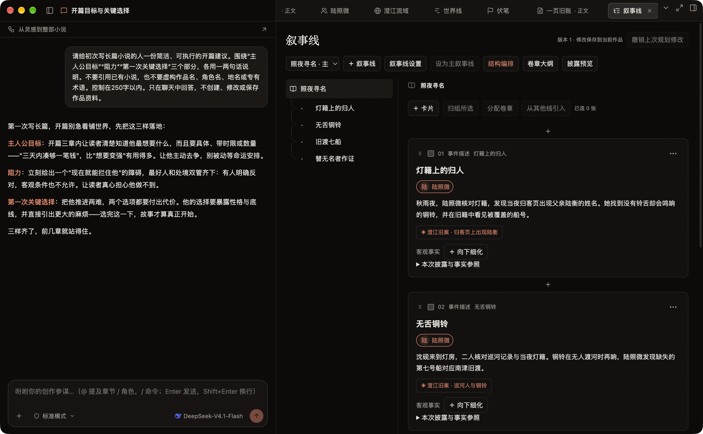
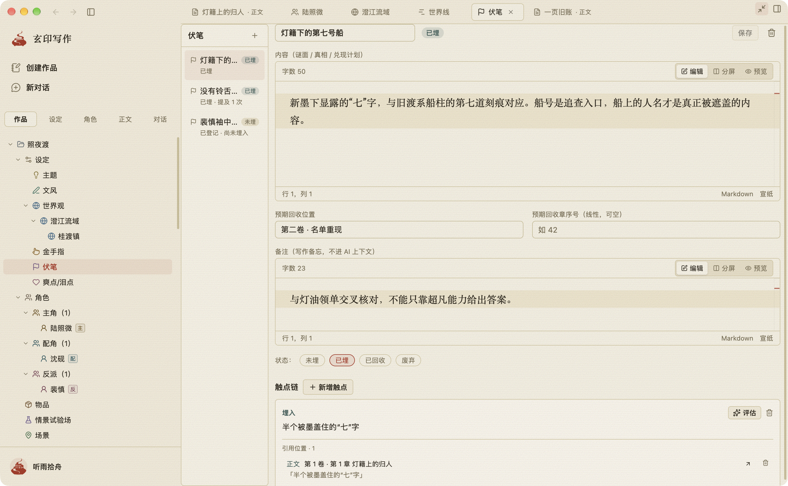

<p align="center">
  <picture>
    <source media="(prefers-color-scheme: dark)" srcset="public/brand/logo-icon-ink.svg">
    
  </picture>
</p>

<h1 align="center">玄印写作 · ShakeInk</h1>

<p align="center"><strong>让灵感成章，让故事生长。</strong></p>
<p align="center">桌面版 · 本地作品 · 自选 AI 模型</p>

<p align="center">
  <a href="#视觉展示">看看工作台</a> ·
  <a href="#核心亮点">了解亮点</a> ·
  <a href="#安装与运行">源码运行</a>
</p>

## 项目简介

**玄印写作是一款面向长篇小说的开源桌面 AI 创作工作台。** 从一个念头到一部作品，把人物、世界、剧情、伏笔与正文放进同一个创作空间，让散落的灵感逐步连成故事。

你可以先搭建世界、梳理人物，再安排事件与卷章；也可以从一段正文出发，边写边补全故事的来龙去脉。作品保存在你选择的本地目录，AI 使用你自行配置的文本与图像模型，陪你构思、推敲和修改。

## 视觉展示

### 资料、对话与正文，同屏衔接

[](docs/readme-assets/ai-workspace-three-column-paper.png)

左侧管理创作资料，中间与 AI 推敲开篇，右侧回看正文，让构思与写作在同一工作台衔接。

### 从人物内心，找到行动的理由

[](docs/readme-assets/characters-paper.png)

从表层目标到深层信念，梳理角色行动背后的欲望、恐惧与动机。

### 把事件、人物与章节连起来

[](docs/readme-assets/planning-ink.png)

按时间组织事件，同时查看关联人物与对应章节。

### 安排讲述顺序，掌握信息揭露

[](docs/readme-assets/narrative-ink.png)

用叙事卡片编排讲述顺序，结合人物视角与事件参照，逐步安排信息揭露。

### 每条伏笔，都有正文出处

[](docs/readme-assets/foreshadows-paper.png)

记录伏笔、安排回收，并沿章节触点找到原文。

## 功能一览

| 能力 | 可以做什么 |
| --- | --- |
| **AI 辅助创作** | 自选文本与图像模型，引用创作资料，使用创作命令、候选稿与评审入口 |
| **人物与世界** | 管理身份、心理、能力、弧线与关系，组织层级世界、地理及社会设定 |
| **剧情规划** | 编排世界线、叙事线、事件、人物视角与卷章结构 |
| **伏笔管理** | 记录埋设、提及与回收状态，维护触点及正文引用 |
| **正文与成稿** | Markdown 编辑、分屏与预览，稿件版本管理，TXT / Markdown / DOCX / PDF 导出 |
| **桌面与本地** | 本地作品目录、多标签与可收起面板、三种主题模式、原生菜单及可配置快捷键 |

## 核心亮点

### 让 AI 带着你的故事思考

**把创作资料带进对话，让讨论接上已有的故事。** 用 `@` 引用章节、角色等资料，通过 `/` 选择创作命令，围绕人物处境推敲情节、润色段落或发起评审。文本与图像模型可分别配置，构思、写作与修改都能在同一工作区继续。候选稿与版本入口帮助回看不同写法，把是否采用、怎样改写的决定留给作者。

AI 功能需要自行配置模型接口与密钥；调用远程模型时，相关请求会发送至你配置的服务。

### 人物的选择，从内心长出来

**让人物档案成为写作时随手可查的依据。** 身份、外在、心理、能力、弧线与关系各有位置，动机还能逐层展开，从眼前想完成的目标，一直追问到长期坚持的价值。把欲望、恐惧与信念放在一起，写到人物作出艰难选择时，就有一份可以回看的内心脉络；长篇中的变化也能沿着人物弧线持续整理。

### 给世界立规矩，也给故事留根基

**把庞大的世界拆成有层次、可维护的设定。** 可以为世界建立子区域，再补充地理、社会等资料。地区之间如何往来、不同群体遵循什么制度、特殊能力受到哪些限制，都能围绕同一部作品保存。需要推进情节时，随时回查地点与规则，让新的场景和冲突有据可依，也为后续扩展留下清楚的结构。

### 故事如何发生，读者何时知道

**同时照看事件的时间与故事的讲法。** 世界线组织事件实际发生的顺序、持续时间和关联人物；叙事线安排讲述顺序、视角与卷章结构。先梳理事件的因果关系，再安排信息的揭露时机，把事情发生的顺序与读者得知的顺序分别规划。事件与章节之间的关联，让你调整一段叙述时，也能回看它在整部故事中的位置。

### 埋下的每条线，都能找到来处

**把线索从一句灵感，变成可以追踪的伏笔。** 谜面、真相方向、预期回收位置与作者备注集中记录，再用未埋、已埋、已回收等状态梳理进度。伏笔的埋入、提及与回收触点可以关联正文引用，记录它出现在哪一章、哪一句，并回到具体段落查看前后文。长篇写到后面，回头续接早先的线索会更有条理。

### 从第一段，写到可交付的稿件

**让设定与规划最终落到可读的正文里。** 按卷章组织内容，用 Markdown 编辑，随时在编辑、分屏与预览之间切换；需要专注时，收起侧栏，把空间留给文字。候选稿与版本帮助保留和回看不同写法，成稿后可导出 TXT、Markdown、DOCX 或 PDF。从素材整理到定稿交付，让同一套工作台承接不同题材的写作过程。

### 宣纸与玄墨，都是你的书房

**让写作环境顺着你的习惯调整。** 宣纸温润明亮，玄墨沉静深色，也可以跟随系统切换；多标签便于在人物、规划与章节间往返，可收起面板留出更宽的阅读空间。原生菜单和可配置快捷键承接日常操作，作品放在你选择的本地目录。本地工作台无需部署网站或外部数据库，打开应用，就能继续整理与写作。

## 支持平台

面向 **macOS（Apple Silicon）/ Windows**。macOS 版仅支持 Apple 芯片（M 系列），不支持 Intel 芯片。

| 平台 | 安装包目标 | 当前验证状态 |
| --- | --- | --- |
| macOS · Apple Silicon（M 系列） | DMG / ZIP | 已有 arm64 开发版运行与真实窗口截图，完整业务验收仍在推进 |
| Windows | NSIS 安装程序 | 已配置打包目标，原生安装与运行待验收 |

当前为 **0.1.0-alpha 开发版**，暂不用于真实创作数据。开发进度与验证范围见[交付进度](docs/00-delivery-status.md)及[验证记录](docs/verification-2026-10-08.md)。

## 安装与运行

当前 [Releases](https://github.com/mySingleLive/shakeink-desktop/releases) 尚无公开发布，可先从源码构建体验。

准备 **Node.js 24、npm 和 Git**，在终端执行：

```sh
git clone https://github.com/mySingleLive/shakeink-desktop.git
cd shakeink-desktop
npm ci
npx playwright install chromium
npm run generate:commands
npm run build
npm start
```

首次安装依赖与构建需要联网。Chromium 用于构建时生成编辑器命令目录；工作台由 Electron 本地协议加载，无需另外启动 HTTP 服务或外部数据库。AI 模型接口与密钥在应用中自行配置。

<details>
<summary>在本机构建安装包</summary>

在匹配目标操作系统与 CPU 架构的机器上安装依赖（macOS 需使用 Apple 芯片 Mac），并完成上述生成步骤后，可选择：

```sh
npm run package:dir
```

生成应用目录，或执行：

```sh
npm run package
```

生成 macOS DMG / ZIP 或 Windows NSIS 安装程序，产物位于 `release/`。两条命令均会先重新构建应用。

当前 macOS 开发产物未签名、未公证；平台验收范围见上表。已有构建与升级检查见[品牌改名验证记录](docs/reviews/130-brand-rename-verification.md)。

</details>

## License

Copyright (c) 2026 mySingleLive。项目采用 [GNU GPL v3.0](LICENSE)（`GPL-3.0-only`）；第三方资源见[来源与许可声明](THIRD_PARTY_NOTICES.md)。
