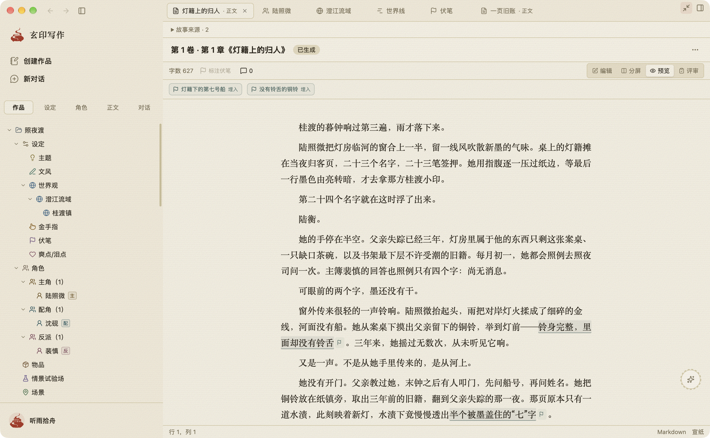
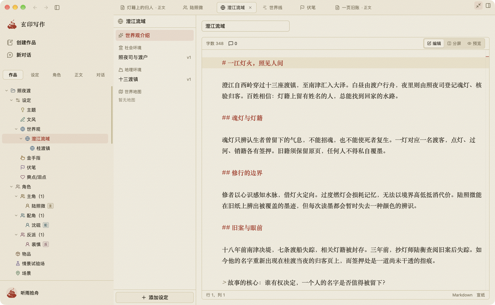
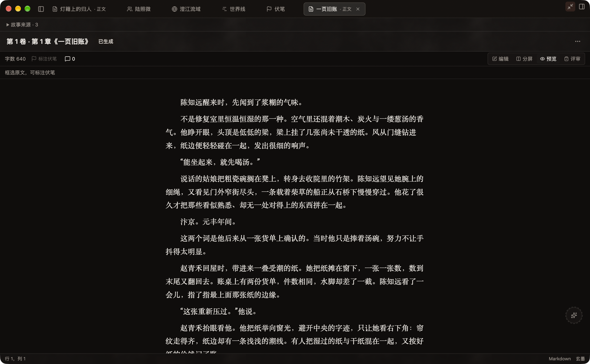
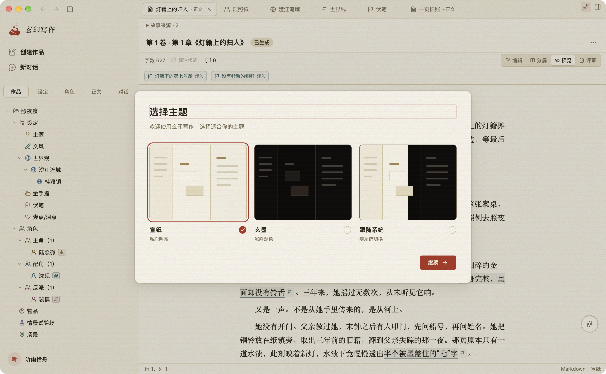
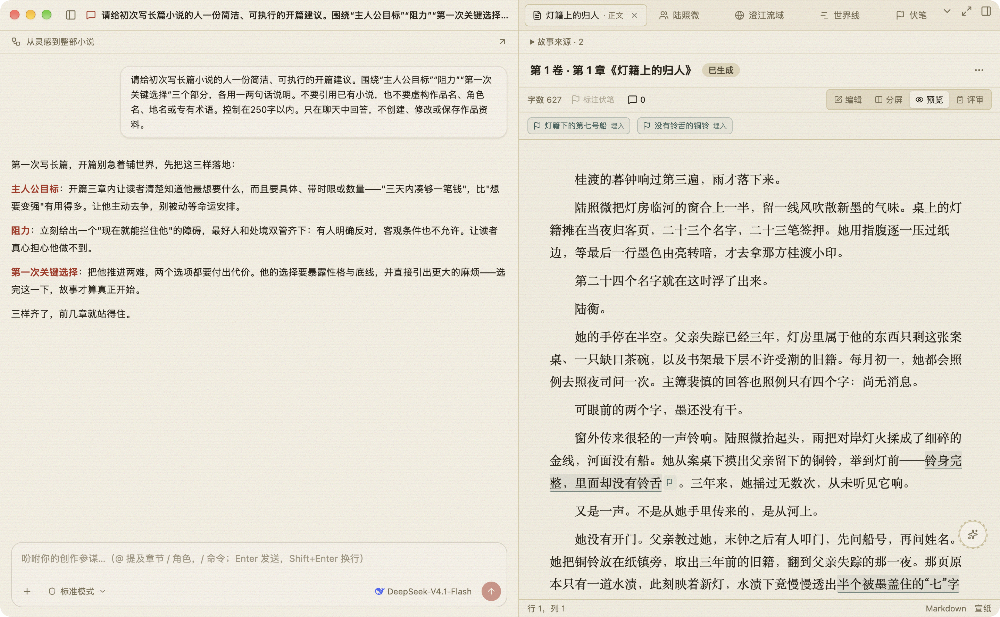

# README 素材制作记录

日期：2026-10-15；补图更新：2026-10-16。前序清单已通过[独立审核](reviews/01-material-checklist-review.md)。原七图记录保留；当前新增 A09 的来源与审核状态见文末及 [07 聊天素材记录](07-chat-materials.md)，不能将原七图的无模型调用说明推广到新增聊天图。

## 数据来源与隔离

展示作品为本次原创虚构的《照夜渡》（仙侠悬疑）与《汴河来信》（历史穿越）。它们被写入本次新建临时目录中的真实 Workspaces/PGlite 数据库，使用正式迁移和 Prisma 模型；不使用设计预览、浏览器假页面或替换后的 DOM。

- 内容源：`scripts/readme/demo-content.ts`。
- 数据生成器：`scripts/readme/seed-demo.ts`。
- 生成器拒绝非空目录、非规范临时路径和符号链接路径；不读取用户默认数据根。
- 已成功生成并读回两本书：六位角色、七章、四篇正文、四个场景、两组规划、三条伏笔。伏笔引用逐条在对应正文中定位，起止偏移与原句匹配。
- 初始种子使用原创虚构笔名「听雨拾舟」、空邮箱和零模型。用户随后自行配置了两个模型；原七图阶段助手未发起模型调用。本次补图已获授权生成真实回复，见文末；全程不解密、不打印、不修改凭据。拍摄前已通过真实 UI 恢复虚构笔名、空邮箱和项目品牌印章头像。不能把当前已有库继续描述为零模型或无 Key。
- 公开文件仅含原创文本、脚本、审核、最终图片和脱敏登记；真实数据库与应用控制文件留在临时目录。目录路径不写入公开登记。
- 正文界面 `WRITTEN` 状态显示「已生成」，这是现有产品对已写入正文的状态标签；正文由人工准备，不能把该标签解释为模型生成了正文。README 第一张图附近分别说明预先准备的原创作品与新增的真实模型聊天回复。

## 安装与构建实际结果

环境：macOS arm64，Node 24.19.0，Electron 44.6.0。

1. `npm ci --no-audit --no-fund`：完成，1003 个依赖。初次沙箱内 DNS 失败，转允许联网的环境重试后成功。
2. `npm run build`：Prisma 生成通过；沙箱中的 Next 构建停滞，停止本次进程后在允许本地构建 IPC 的环境重试，Next 静态 UI 与其 TypeScript 步骤通过。
3. Electron 构建初次遇到 `Stale installed command catalog`。只读比对证实九个源码文件的 CRLF 哈希与已提交目录一致，而 macOS 检出为 LF；未发现命令内容差异。使用项目的 `npm run generate:commands` 及本机 Chrome，生成 417 个 macOS / 401 个 Windows 命令的本地元数据后，`npm run build:desktop` 通过。
4. 命令目录原文件已在构建后恢复，没有将本机构建产生的哈希变化混入 README 修改。试拍使用上述构建，业务源码未改。
5. `npm start` 已启动 `shakeink://app/` 真实工作台，能显示原创正文及伏笔引用。启动时的可选模型引导通过正常「暂不配置」操作关闭；不隐藏错误或修改产品逻辑。
6. 首次全工程类型检查因未生成测试专用 Prisma Client 失败；执行 `npm run generate:test` 补齐后，`npm run typecheck` 通过。这里的构建、类型检查和素材读回不替代业务全量验收。

## 原生窗口截图方式

当前电脑工具使用窗口共享采集，macOS 会把左上角三按钮替换为共享指示条。工具截图和直接采集该共享中的窗口均不满足用户要求，已拒绝作为最终素材。

用户已明确允许 `screencapture`，选择继续只用当前电脑工具，并最新要求由 ComputerUse 自动操作。未执行 Playwright 界面操作；先前的 `capture.mjs` 已删除。正常退出、重新启动后，真实工作台能恢复内容标签、心理等子页及布局，且原生三按钮不被共享条遮挡。此方法已实际用于角色页采集。侧栏分类不跨重启恢复，故通过真实 UI 更新再恢复原书名，使《照夜渡》位于作品目录首位，避免人物/设定归属混淆。

工具只负责启动和系统截图。`workspace-guard.mjs` 核验严格临时目录、fixture 内容哈希、两本作品 catalog、目录身份和 bootstrap 根指针。默认启动仍要求零模型；`launch-demo.mjs --resume-demo` 显式允许恢复用户已配置的同一演示库，其余核验不变。guard 只返回模型数量，不输出对象、解密或调用模型。`capture-native.mjs` 经 `window-id.swift` 只读定位自己启动的 PID 的唯一工作台，再用系统截图保留原像素。共享条检测仅是预检；三个按钮及无错误/隐私仍须逐图验图。

A08 选景修订为全新零模型演示库的真实首次运行主题选择页，用 `--first-run` 写入产品定义的未完成 onboarding 初态，不改产品页面。只展示主题选择，不作为完整设置或字号/字体证据。此修订另经独立子代理审核。

## 初审修订

[素材数据初审](reviews/02-material-data-review.md) 指出三项 P2，现已按意见修订，并通过[数据与工具独立复审](reviews/03-material-data-rereview.md)。此复审不代表图片通过：

- 读墨仅失去一种颜色：正文明确金黄褪成灰白、朱印仍红，与世界和人物能力一致。
- 章节不再按下标机械关联事件：每部作品显式给出 `chapterEvents`，历史穿越第一章关联抵达/货单，第二章关联试修/原单，第三章关联家书船号；时间对应清晨、同日午后与次日。仙侠叩门紧接下一章，规划时间改为十五分钟后。
- 已删除未获授权的 Playwright 脚本；新的启动检查提前核验 data、bootstrap、根指针的路径/身份，以及两本作品路径，失败直接停止。
- 同步修正「姓氏」为「姓名」，扩充独立读回为各章标题/正文/章纲、世界说明、规划全文、场景数量和伏笔/触点数量。修订后已重新生成全新隔离库，全部读回断言通过。
- 启动 guard 已实际执行五项检查：正常演示根通过、重定向根指针拒绝、bootstrap 符号链接拒绝、外部作品目录拒绝、恢复后正常通过。三个原生辅助 `.mjs` 文件均通过 `node --check`。

## 最终图片

七张最终图片已全部采集并通过[独立逐图审核](reviews/06-final-material-review.md)，登记见 [尺寸与 hash 清单](03-material-manifest.json)。前次首图被独立审核指出目录与正文不一致、身份来源不明；已恢复原创身份并整理作品顺序，最终图片将重拍覆盖。前次问题已重拍覆盖，最终审核确认闭环。

原七图阶段未采用可选 A09，当时助手没有为摄影调用模型。本次按用户新增授权采用真实回复补图，见文末；仍不伪造 AI 回复、候选稿、评分或生成回执。

当前已完成全部七图与独立逐图审核，可进入 README 大纲及独立审核，随后提交用户审核。根 `README.md` 保持原文。

## 七张素材预览

这些是当前源码构建的真实 macOS arm64 Electron 窗口，均保留原生三按钮。演示作品与正文为预先准备的原创虚构内容；助手未为摄影调用模型。界面「已生成」为现有正文状态标签，不代表本次发生了模型生成。六张业务图使用用户已手动配置两模型的隔离库；主题图使用独立新建零模型库。所有演示窗口已正常退出。

| 素材 | 作品与画面 | 尺寸 |
| --- | --- | --- |
| A02 | 《照夜渡》正文预览与作品目录 | 2880 × 1778 |
| A03 | 陆照微的心理、分层动机与信念 | 2880 × 1778 |
| A04 | 澄江流域介绍与分层设定 | 2880 × 1778 |
| A05 | 玄墨世界线、四事件及人物/章节关联 | 2880 × 1778 |
| A06 | 灯籍下的第七号船、状态与正文触点 | 2880 × 1778 |
| A07 | 《汴河来信》正文预览，收起侧栏专注阅读 | 2880 × 1778 |
| A08 | 首次运行的宣纸、玄墨、跟随系统选择 | 2880 × 1780 |

七图总计约 33.8 MiB，原始 PNG 像素与比例保留；最后一图系统窗高相差 2 个物理像素，没有为齐边而裁去窗框。品牌 Logo 复用 `public/brand/` 现有文件，没有另造或重新许可品牌。截图通过 `copyFile` 保存原文件，未涂抹、拼接、合成或补画窗控。种子在两本作品建立后更新第一本作品的更新时间，使正常列表把当前正文所属作品排首，不更改界面排序逻辑。

### A02 · 一部作品，从设定到正文

### A03 · 人物的选择，来自人物的内心

### A04 · 世界规则与层级设定

### A05 · 故事发生的顺序与章节关联

### A06 · 每条线索都有正文出处

### A07 · 玄墨下的历史市井正文

### A08 · 选择自己的书房主题

## README 引用范围

七张成图均为已审核的素材交付。根据用户后续排版意见，本版 README 仅在视觉展示精选其中五张：工作台、人物心理、世界线、伏笔、历史穿越正文。世界与主题图保留在本素材档案，README 功能一览及各项亮点不插图；此调整不修改原图或既有素材审核结论。

## A09 · 新增真实 AI 聊天主图 · 2026-10-16

用户在正文审核中要求增加含 AI 聊天内容的截图，并确认原图内的演示小说内容保留、README 文案使用通用说明。实际请求与来源见 [07-chat-materials.md](07-chat-materials.md)。两条获准 UI 用户消息已发送，第二条为完整通用写作问题并获得实际模型回复；没有向模型发送真实作品，没有人工插入或修改 assistant 消息。

新增 `ai-workspace-paper.png` 保留原生窗控、正文与完整聊天回复，用原始 PNG 替换 README 的旧工作台主图。其他四张引用不变，总数仍为五张；旧七图作为历史素材保留。新增图与脚本须另行独立审核，旧整组通过不自动覆盖新增文件。

新增图与脚本已通过 [12 独立素材审核](reviews/12-ai-material-review.md)。公开 PNG 与系统原图同字节；主代理再次核验全部八张文件的完整 hash/字节数均匹配 manifest，原七图未改。manifest 保留旧 06 引用，新图单列 12，另登记当前 README 五图选择。演示应用已正常退出。

## 后续三栏与叙事线增补

按用户新增反馈，完成 `ai-workspace-three-column-paper.png` 与 `narrative-ink.png` 两张原生素材，原八图未覆盖。前者导航、原 AI 问答及正文完整同屏；后者为真实玄墨叙事结构，同时保留原聊天。构建、选景、仅整理会话标题但不改消息的过程见 [09 补充修订](09-layout-revision.md)。本轮零新模型请求，当前总素材十张，不等于 README 引用十张。

两新图现已通过 [16 独立逐图审核](reviews/16-three-column-narrative-material-review.md)：原分辨率看图、原图同字节、来源与标题准备回执均通过。manifest 按新旧审核分别登记十图通过，当前五图顺序为三栏工作台、人物心理、世界线、叙事线、伏笔。旧纯正文及旧 AI/正文主图继续保留在素材档案。
